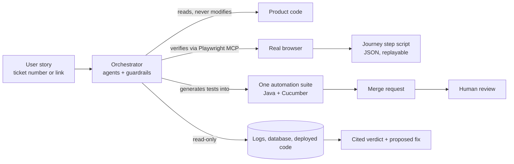

# AI QA Orchestrator

A reference design for an **agentic QA workflow**: give it a user story and it reads the story and the code, drafts test cases, verifies the feature in a real browser, reports bugs with evidence, turns the finished cycle into automation, and triages bugs to a cited root cause.

It orchestrates. It never becomes a second test framework, and it never writes to anything without approval.

> **About this repo.** This is an independent, generic write-up of design ideas and a small runnable example. It contains no employer code, data or configuration. Every example runs against the public practice site [saucedemo.com](https://www.saucedemo.com/).

---

## The idea in one picture



## What it does, per story

1. **Learns** the story and the code behind it
2. **Drafts** test cases a tester would actually run
3. **Verifies** the feature in a real browser (Playwright via the Model Context Protocol)
4. **Reports** bugs with screenshots, logs and, where useful, video
5. **Automates**: Cucumber features, step definitions and page objects, written to the suite's own conventions and delivered as a merge request
6. **Triages**: given a bug ticket, correlates logs, database state and deployed code into one cited root cause and a proposed fix

## Four design decisions

| # | Decision | Why |
|---|---|---|
| 1 | **One suite executor.** Every run goes through the existing suite. | A parallel framework doubles maintenance and splits the truth. |
| 2 | **One generated artifact.** A generated test is a feature file, step definitions and page objects, delivered as a merge request. | Reviewers already know how to review it. |
| 3 | **Browser findings are recorded as journeys** (JSON step scripts), replayable headless. | A verification you can re-run is worth more than a screenshot. |
| 4 | **Read-only by default.** Writes sit behind an approval step. | Trust comes from what the system *cannot* do unattended. |

Details: [`docs/design-decisions.md`](docs/design-decisions.md)

## Every failure gets one verdict

**Product defect · Test defect · Environment issue · Data issue.**
A failing check is never "fixed" by loosening its assertion. See [`docs/verdicts.md`](docs/verdicts.md).

## The agent team

| Agent | Job | Boundary |
|---|---|---|
| Researcher | Reads story, comments and code; writes a cited brief | Read-only |
| Scout | Explores a live screen and records which selectors and waits really worked | Read-only against the UI |
| Generator | Writes the feature, steps and page objects to the suite's standards | Never commits or opens the MR itself |
| Healer | Repairs a stale locator by appending a fallback | Never heals a server error or a missing element |
| Investigator | Triage: logs + data + code to a cited root cause and a proposed diff | Never writes anywhere, never applies the fix |

Sample definitions: [`examples/agents/`](examples/agents/) · Roles in depth: [`docs/agents.md`](docs/agents.md)

## Try the runnable example

A small journey runner that replays a recorded browser journey headless, with the read-only guard and fallback locators built in.

```bash
pip install playwright
playwright install chromium
cd examples/journey-replay

# read-only journey: runs
python replay_steps.py journeys/login-and-browse.steps.json

# journey that changes state: blocked until you opt in
python replay_steps.py journeys/add-to-cart.steps.json
python replay_steps.py journeys/add-to-cart.steps.json --allow-mutation
```

Exit codes: `0` pass · `1` assertion failed (candidate product defect) · `2` every locator exhausted (needs a human or the healer) · `3` blocked by the mutation guard.

Format reference: [`docs/journeys.md`](docs/journeys.md)

## Repository layout

```
docs/                    design decisions, verdicts, agents, journey format
examples/
  agents/                sample agent role definitions
  journey-replay/        runnable replay script + two sample journeys
  cucumber/              illustrative feature, steps and page object
  operating-contract.md  a sample always-loaded rules file
```

## The lesson that mattered most

The AI was not the hard part. **Teaching it the domain was**: how the product really behaves, what each environment means, how to tell a real failure from environment drift, and the conventions of the existing suite. An agent without that writes confident, plausible, wrong tests.

## License

MIT. See [`LICENSE`](LICENSE).
